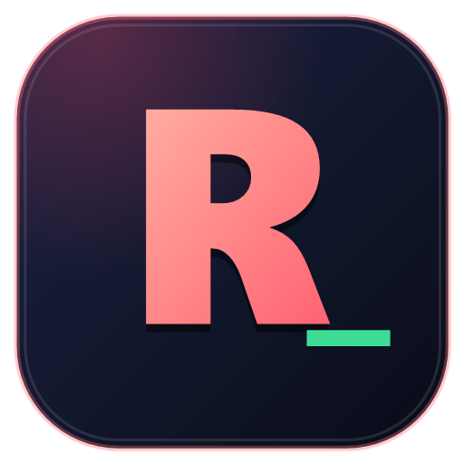
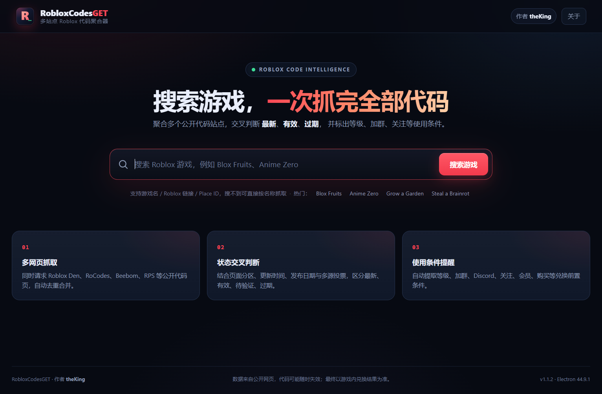
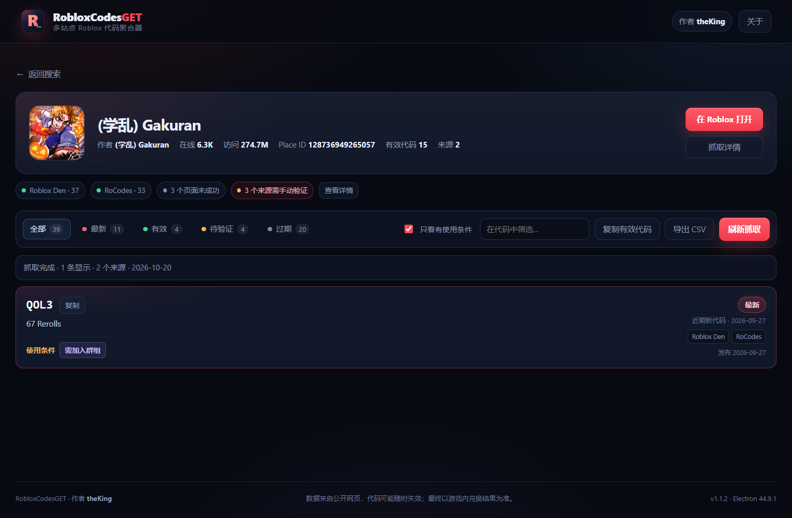
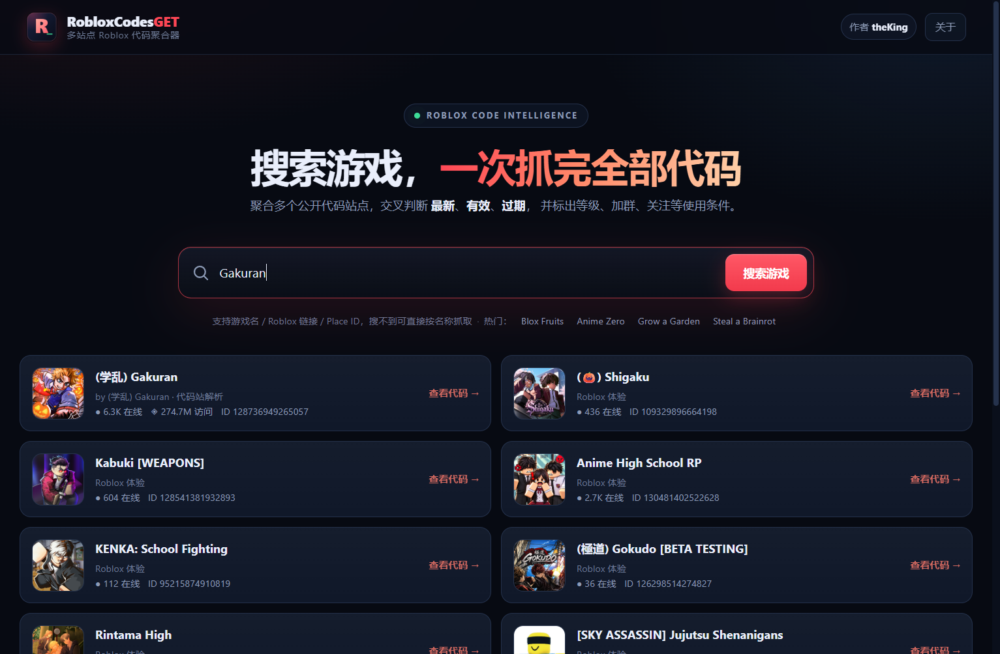

# RobloxCodesGET

<p align="center">
  
</p>

<p align="center">
  <b>Roblox 代码聚合与游戏搜索桌面工具</b><br>
  多站点抓取 · 合并去重 · 有效性判断 · 使用条件提醒
</p>

<p align="center">
  
  
  
  
</p>

> 数据来自公开网页；代码可能随时失效，最终以游戏内兑换结果为准。
> 使用前请阅读 [免责协议](DISCLAIMER.md)。

---

## 目录

- [这是什么](#这是什么)
- [截图](#截图)
- [功能](#功能)
- [请求稳定性优化](#请求稳定性优化)
- [下载与运行](#下载与运行)
- [从源码运行](#从源码运行)
- [打包](#打包)
- [状态规则](#状态规则)
- [使用条件识别](#使用条件识别)
- [数据源](#数据源)
- [项目结构](#项目结构)
- [开发说明](#开发说明)
- [已知限制](#已知限制)
- [许可与免责](#许可与免责)

---

## 这是什么

一个轻量的 Windows 桌面工具：搜索 Roblox 游戏，抓取多个公开代码站点，合并去重后给出
**最新 / 有效 / 待验证 / 过期** 判断，并把代码的使用条件（等级、加群、Discord、关注、会员等）直接标在界面上。

**它不是什么**：不是 Roblox 官方工具，不读改写游戏内存，不改客户端文件，不自动兑换，不登录账号，不自动破解人机验证。

## 截图

| 首页搜索 | 代码列表与使用条件 |
| --- | --- |
|  |  |



## 功能

- **Roblox 游戏搜索**：使用 Roblox 官方 `search-api/omni-search` 接口，支持游戏名、Roblox 游戏链接、Place ID。
- **搜索兜底**：官方搜索未收录某款游戏时，会用 Roblox Den / RoCodes 反查 Place ID 并补齐游戏信息（例如 `Gakuran`）；仍找不到时可直接按名称抓取代码。
- **多网页抓取**：同时尝试 Roblox Den、RoCodes、Beebom、Rock Paper Shotgun、Gamer Journalist、Try Hard Guides 等公开代码页。
- **自动合并去重**：同一个代码在多个站点出现时合并为一条，保留来源链接、奖励、更新时间和状态投票。
- **有效性判断**：
  - 结合页面分区（Working / Expired）、`dateModified`、发布日期、站点校验状态与多源结果。
  - 冲突时标记为"待验证"，不强行判有效。
  - 页面过旧时提示"建议游戏内验证"。
- **最新代码识别**：
  - 来源提供发布日期且 ≤ 45 天；
  - 页面存在明确的 new codes 分区；
  - 本地历史里首次发现的新代码（持续 14 天）。
- **使用条件提醒**：
  - 等级要求（如 `等级 50+`）
  - 加入 Roblox 群组
  - 加入 Discord
  - 关注 / 订阅作者频道
  - Game Pass、会员/VIP、购买/消费、游玩时长、转生/阶级、任务、账号年龄、限量、地区等
  - 条件从代码描述中提取，鼠标悬停可查看原文依据。
- **Cloudflare 系统浏览器验证（推荐）**：抓取详情里点「系统验证」，用本机 Edge/Chrome 手动完成验证，应用通过本地 CDP 自动读取页面并写入缓存，再重新抓取；「应用内验证」保留为备选。不再自动弹窗，避免反复验证。
- **实用操作**：一键复制单个代码、复制全部有效代码、导出 CSV（带 BOM，Excel 可直接打开）。

## 请求稳定性优化

- **持久会话**：所有页面请求走 Electron 的持久 Session，并与手动验证窗口共享 Cookie；完成一次验证后，后续请求会复用该站点的会话。
- **浏览器指纹一致**：内置窗口的 UA 自动跟随实际 Chromium 版本，避免 UA 与内核版本不一致导致验证循环。
- **系统浏览器验证**：使用真实 Edge/Chrome 的独立配置目录，验证通过后由应用读取页面 HTML；该页面会写入缓存，后续抓取直接复用。
- **同域限速**：同一域名串行请求，间隔 180–350ms，避免短时间并发触发站点风控。
- **失败重试**：遇到 429 / 502 / 503 / 504 时，按 `Retry-After` 等待后自动重试一次。
- **页面缓存**：成功抓取的 HTML 写入本地 `page-cache`，保留 7 天；当站点拒绝、超时或返回非网页内容时，用缓存补位，并在来源标签上标注"缓存"。
- **内容校验**：拒绝把图片、二进制等非 HTML 响应当作网页解析，避免误判为"没有代码"。
- **验证策略**：Cloudflare 等交互验证仍由用户手动完成；自动弹窗已关闭。手动验证后若显示 404 或连续 3 次仍在验证，会自动停止并提示原因。

## 下载与运行

**打包版**（推荐普通用户）：

1. 从 [Releases](../../releases) 下载 `Roblox代码获取-v1.1.2-win64-By-theKing.zip`；
2. 解压整个文件夹（不要只拖出 exe）；
3. 双击 `RobloxCodesGET.exe`。

- 首次运行 Windows SmartScreen 可能提示"未知发布者"，选择"更多信息 → 仍要运行"。
- 软件不需要登录 Roblox 账号，需要联网。

**源码包**：`RobloxCodesGET-v1.1.2-source.zip`，或直接 `git clone` 本仓库。

## 从源码运行

要求：Windows 10/11 x64、Node.js 20+、npm。

```bash
npm install
npm start
```

> Electron 二进制下载失败时，可设置镜像后重试：
>
> ```bat
> set ELECTRON_MIRROR=https://npmmirror.com/mirrors/electron/
> npm install
> ```
>
> 打包时也可以直接复用已下载的 Electron zip 目录，避免重复下载：
>
> ```bat
> set ELECTRON_ZIP_DIR=D:\path\to\electron-zips
> npm run pack
> ```

## 打包

```bash
npm run dist
```

或分步：

```bash
npm run icon   # 生成 build/icon.png / build/icon.ico
npm run pack   # 生成 dist/RobloxCodesGET-win32-x64
npm run zip    # 生成 release/ 下的 win64 包、源码包与 SHA256.txt
```

冒烟测试（会真实联网）：

```bash
npm run test:crawl -- "Anime Zero"
```

## 状态规则

| 状态 | 判定逻辑 |
| --- | --- |
| **最新** | 有效，且来源给出 ≤45 天发布日期、明确 new 分区，或本地首次发现 ≤14 天 |
| **有效** | 至少一个来源标记有效；无过期冲突；最新来源更新时间 ≤120 天 |
| **待验证** | 来源冲突、来源仅标记"待检查"、页面较旧，或只有无法定性的来源 |
| **过期** | 来源明确标记过期，且没有更新的有效证据 |

多源冲突时比较来源更新时间；只有一方明显更新（>30 天）才会覆盖另一方，否则保留"待验证"。

## 使用条件识别

从代码描述与列表中提取，支持中英文页面：

- 等级 / Lv / level：`等级 50+`
- 群组：`需加入群组`
- Discord：`需加入 Discord`
- 关注/订阅：`需关注/订阅`
- Game Pass、会员/VIP、购买/消费
- 游玩时长、转生/阶级、任务、账号年龄、限量、地区等

> 条件为文本推断，可能因站点描述不完整而漏标。兑换前请以游戏内提示为准。

## 数据源

- Roblox 官方游戏搜索与游戏详情 / 图标接口
- [Roblox Den](https://robloxden.com/)
- [RoCodes](https://rocodes.gg/)
- [Beebom](https://beebom.com/)
- [Rock Paper Shotgun](https://www.rockpapershotgun.com/)
- 通过 Bing 索引发现，并按域名白名单抓取的公开代码页（Gamer Journalist、Try Hard Guides、Pro Game Guides 等）

部分站点使用 Cloudflare 防护。抓取失败后，在"抓取详情"里点击对应来源的「系统验证」，
用本机 Edge/Chrome 完成验证；应用会读取验证后的页面并写入缓存，然后重新抓取。
「应用内验证」作为备选。自动弹窗已关闭，避免同一站点反复弹出验证。
验证窗口关闭、超时、显示 404 或连续 3 次仍要求验证时会自动停止，不影响其他来源。
软件不会绕过登录、付费墙或验证码，验证始终由用户手动完成。

## 项目结构

```
RobloxCodesGET/
├─ src/
│  ├─ main.js              Electron 主进程、IPC、浏览器兜底抓取
│  ├─ preload.js           contextBridge API
│  ├─ lib/
│  │  ├─ roblox.js         官方搜索、详情、图标
│  │  ├─ crawler.js        候选页面、并发抓取、合并判断
│  │  ├─ sources.js        数据源与 URL 规则
│  │  ├─ parsers.js        结构化 / 通用代码页解析
│  │  ├─ requirements.js   等级、加群等条件提取
│  │  ├─ history.js        本地首次发现记录
│  │  ├─ system-verify.js  系统 Edge/Chrome + CDP 验证
│  │  └─ util.js           fetch、日期、slug、并发工具
│  └─ renderer/            界面（原生 HTML/CSS/JS）
├─ scripts/
│  ├─ make-icon.ps1        生成 R 图标 PNG/ICO
│  ├─ package-app.js       Electron 打包（排除测试与开发目录）
│  ├─ package-zip.ps1      压缩 + SHA256
│  └─ test-crawl.js        网络抓取冒烟测试
├─ build/                  图标资源
├─ packaging/              随包说明
├─ LICENSE                 MIT 许可 + 第三方内容说明
├─ DISCLAIMER.md           免责协议与使用条款
└─ package.json
```

## 开发说明

- Electron 44 + 原生渲染层，不使用前端框架。
- `contextIsolation: true`、`nodeIntegration: false`、`sandbox: true`。
- 所有网络请求在主进程完成，渲染层只能通过 preload 暴露的 IPC 调用。
- 外部链接只允许 `http/https`，由系统浏览器打开。
- 站点强制返回 403 时，会尝试用隐藏 Chromium 窗口做一次浏览器抓取（最多 2 个并发）。
- 测试：`npm run test:crawl -- "Anime Zero"`（会真实联网）。

## 已知限制

- 游戏名称与代码站 slug 不一致时可能找不到页面；可在搜索框直接粘贴 Roblox 游戏链接。
- Cloudflare 站点需要手动点击「系统验证」；若系统浏览器仍持续验证，可用「打开」自行查看。
- 系统浏览器验证会创建一个独立的 Edge/Chrome 配置目录（`verify-browser`），不会影响日常浏览器资料。
- 状态判断是启发式结果，不替代游戏内实际兑换。
- 首次使用没有本地历史基线，因此"最新"主要依赖来源发布日期；"新发现"标记从第二次抓取开始生效。

## 许可与免责

- 源代码以 [MIT License](LICENSE) 发布，Copyright © 2026 theKing。
- 使用条款、第三方内容声明与责任限制见 [DISCLAIMER.md](DISCLAIMER.md)。
- 本项目与 Roblox Corporation 及任何游戏开发商无隶属、合作或背书关系；"Roblox" 为其权利人的商标。
